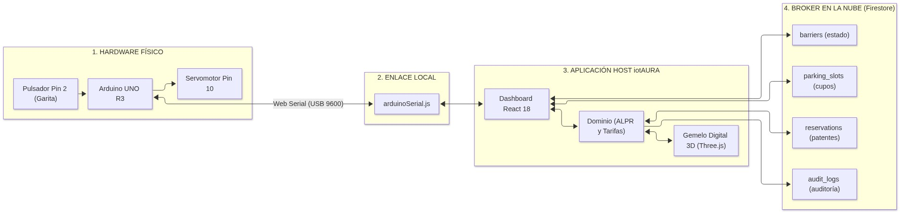
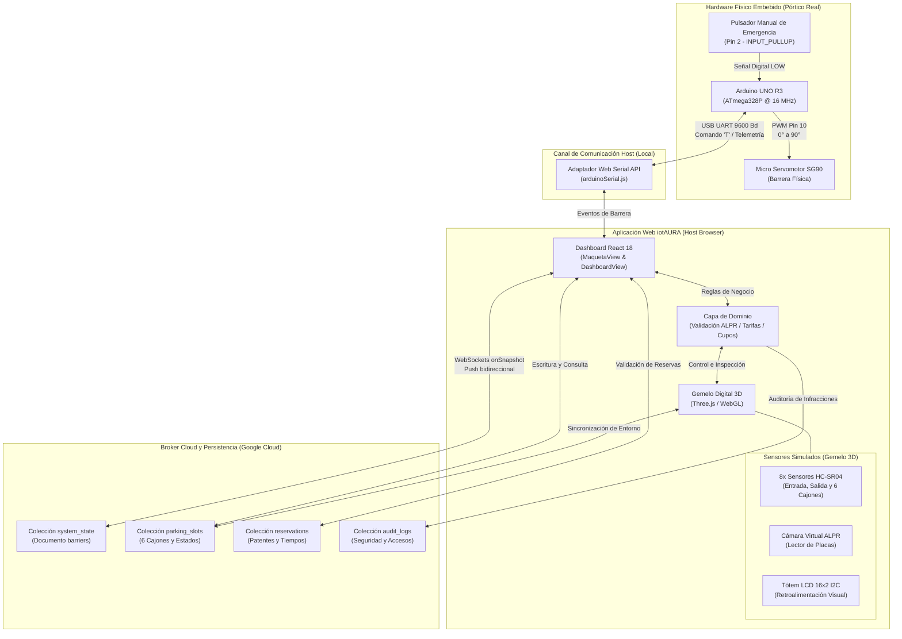
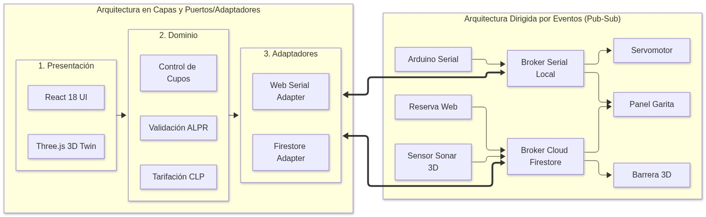
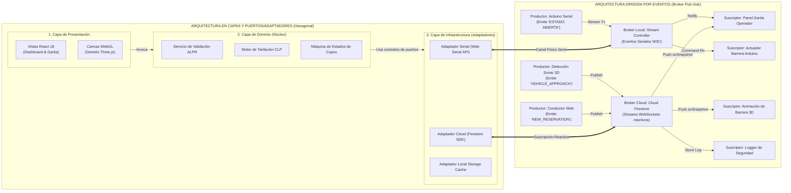
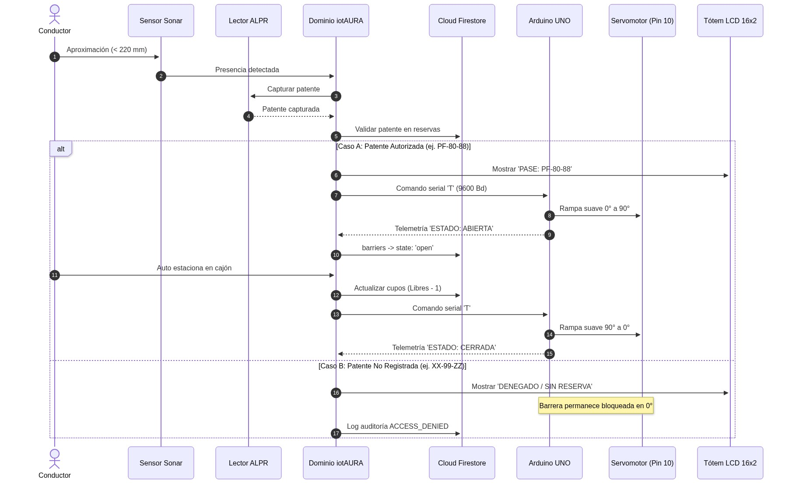

# INFORME FINAL DE PROYECTO
## Integración de Arquitecturas de Software en un Proyecto IoT

---

### DATOS INSTITUCIONALES Y DEL PROYECTO
- **Nombre del Proyecto:** iotAURA – Sistema Inteligente de Gestión y Control de Acceso de Estacionamientos IoT con Gemelo Digital 3D
- **Asignaturas Articuladas:** Arquitectura de Software & Internet de las Cosas (IoT)
- **Docente / Profesor de Asignatura:** Prof. Osvaldo Archile
- **Integrantes del Equipo:**
  - Paul Ferrada
  - Fabián Mora
  - Felipe Labarca
  - Agustín Cañas
- **Carrera:** Ingeniería Civil en Informática / Ingeniería de Ejecución en Informática
- **Fecha de Entrega y Presentación:** Martes 24 de Noviembre (Semana de la Informática)
- **Repositorio Oficial de Código:** [https://github.com/PaulFL808/iotAURA.git](https://github.com/PaulFL808/iotAURA.git)
- **Despliegue Web en Producción (GitHub Pages):** [https://paulfl808.github.io/iotAURA/](https://paulfl808.github.io/iotAURA/)
- **Entorno Gemelo Digital 3D en Vivo:** [https://paulfl808.github.io/iotAURA/maqueta3d.html](https://paulfl808.github.io/iotAURA/maqueta3d.html)

---

## 1. RESUMEN EJECUTIVO

El presente informe documenta el diseño, la justificación arquitectónica, la implementación de hardware y software, y el despliegue del proyecto **iotAURA**, una plataforma ciberfísica e IoT concebida para modernizar y automatizar de forma integral la gestión de estacionamientos universitarios y comerciales.

### El Problema
Los sistemas tradicionales de estacionamiento presentan graves fallas de eficiencia: congestión en las zonas de acceso debido a la validación manual o de ticket físico, falta de información en tiempo real sobre la disponibilidad efectiva de plazas de aparcamiento, y ausencia de mecanismos de sincronización reactiva entre los operadores de seguridad en garita y los conductores que se aproximan al recinto. Esto genera pérdidas de tiempo, emisiones contaminantes innecesarias por búsqueda ciega de cupos y brechas de seguridad perimetral.

### La Solución IoT: iotAURA
iotAURA resuelve esta problemática mediante un ecosistema ciberfísico articulado en tres capas operativas:
1. **Control de Acceso Físico en Tiempo Real:** Implementado con una placa controladora **Arduino UNO R3**, conectada a un actuador servomotor de alto torque (SG90 en Pin 10) que comanda la barrera vehicular, y un pulsador físico de anulación manual de emergencia (Pin 2 con debouncing). La comunicación bidireccional local con la estación de control se efectúa mediante el estándar W3C **Web Serial API** a 9600 baudios.
2. **Nube Reactiva y Broker de Datos:** Integración con **Google Cloud Firestore**, configurado como un broker de eventos en la nube que distribuye instantáneamente las mutaciones de estado de barreras, cupos y reservas mediante streams WebSockets (`onSnapshot`), eliminando el sondeo periódico (*polling*).
3. **Gemelo Digital 3D (Simulador Ciberfísico):** Entorno virtual interactivo desarrollado en **Three.js / WebGL**, que simula la red completa de 6 cupos con sensores ultrasónicos HC-SR04, dinámica de colisión vehicular y un sistema de Reconocimiento Automático de Placas de Matrícula (**ALPR - Automatic License Plate Recognition**), que autoriza o deniega el paso comparando las patentes en tiempo real contra las reservas activas en la nube.

### Integración de Arquitecturas de Software
Para garantizar que la solución sea modular, extensible y tolerante a fallos, se integraron formalmente dos estilos arquitectónicos complementarios:
- **Arquitectura Dirigida por Eventos / Broker Pub-Sub (Event-Driven Architecture):** Modela el intercambio de información entre nodos heterogéneos y físicamente distribuidos (nube Firestore a nivel global y streaming de eventos Web Serial a nivel local), desacoplando espacial y temporalmente a productores y consumidores de eventos.
- **Arquitectura en Capas con Puertos y Adaptadores (Clean / Hexagonal Architecture):** Organiza el cliente web y la lógica de control aislando el dominio de negocio (reglas de reserva, tarifas, validación de patentes) de las tecnologías concretas de entrada/salida (servomotores, Cloud Firestore, Web Serial, Canvas 3D).

---

## 2. DESCRIPCIÓN DEL PROYECTO

### 2.1 Contexto y Problema Abordado
En la actualidad, la movilidad urbana y la infraestructura de campus educativos enfrentan un desafío crítico en la gestión de sus estacionamientos. La carencia de visibilidad en tiempo real provoca cuellos de botella en los accesos vehiculares, maniobras de riesgo por saturación y una asignación ineficiente de plazas. Asimismo, la falta de integración entre las compuertas físicas y los sistemas digitales de reserva impide una fiscalización fidedigna de qué vehículos tienen autorización legal para ingresar al recinto en un instante dado.

### 2.2 Objetivos
- **Objetivo General:**
  Diseñar, implementar y evaluar una plataforma IoT integral de control de acceso y monitoreo de estacionamientos en tiempo real, integrando hardware físico embebido, almacenamiento reactivo en la nube y un gemelo digital 3D bajo una arquitectura de software desacoplada, resiliente y escalable.
- **Objetivos Específicos:**
  1. Construir un controlador de hardware físico con Arduino UNO capaz de maniobrar una barrera servocontrolada y procesar comandos seriales bidireccionales con retroalimentación de estado.
  2. Implementar un broker reactivo en la nube utilizando Google Cloud Firestore para sincronizar en tiempo real el estado de los cupos, barreras y eventos de auditoría entre múltiples clientes conectados.
  3. Desarrollar un gemelo digital 3D interactivo que simule la telemetría de sensores ultrasónicos y la fiscalización por reconocimiento automático de patentes (ALPR), conectado a las mismas fuentes de datos que el hardware físico.
  4. Articular el sistema bajo dos arquitecturas de software reconocidas: Arquitectura Dirigida por Eventos y Arquitectura en Capas / Puertos y Adaptadores, demostrando su complementariedad técnica.

### 2.3 Beneficiarios del Sistema
- **Conductores y Usuarios:** Disponen de una interfaz web responsive para consultar disponibilidad en tiempo real, reservar una plaza con antelación, pagar la tarifa exacta y acceder de manera fluida y automatizada mediante la lectura de su placa patente.
- **Operadores de Seguridad y Garita:** Cuentan con un panel de telemetría en vivo que les notifica cada evento de acceso (autorizado o denegado), alertando sobre intentos de ingreso no autorizados y ofreciendo un botón físico de anulación manual para situaciones de emergencia o contingencias de red.
- **Administradores del Recinto:** Obtienen métricas consolidadas sobre el porcentaje de ocupación, horas de mayor afluencia, ingresos monetarios recaudados y pistas de auditoría inmutables de seguridad.

### 2.4 Funcionamiento General
El sistema opera en un ciclo cerrado de telemetría, validación y control:
1. **Reserva previa:** El usuario ingresa al portal web de iotAURA, selecciona un cupo disponible e introduce su patente vehicular (por ejemplo, `PF-80-88`). La reserva se almacena en Firestore y se publica en el canal de eventos.
2. **Aproximación vehicular:** Cuando un vehículo se aproxima al punto de acceso (físico o en la maqueta virtual 3D), un sensor ultrasónico detecta su presencia a una distancia umbral predeterminada (`TH_ENT = 220 mm`).
3. **Reconocimiento y Validación (ALPR):** La cámara virtual o el operador capturan la placa patente. El subsistema de dominio consulta el broker de reservas en tiempo real.
4. **Toma de Decisión y Accionamiento:**
   - **Caso Autorizado:** Si la patente coincide con una reserva activa, el sistema emite el evento de autorización. El tótem informativo muestra `"PASE: [PATENTE]"` y se envía el comando serial `'T'` hacia el Arduino UNO. El microcontrolador comanda el servomotor hacia los 90° con rampa de velocidad controlada (`velocidad = 20 ms/grado`) y responde por el puerto serial `"ESTADO: ABIERTA"`.
   - **Caso Denegado:** Si la patente es aleatoria o no posee reserva (por ejemplo, vehículos de prueba `XX-99-ZZ` o `NR-40-40`), la barrera permanece bloqueada a 0°, el tótem 3D proyecta la alerta `"DENEGADO / SIN RESERVA"` y se despacha un evento de auditoría (`ACCESS_DENIED`) hacia la nube.
5. **Cierre de Ciclo:** Tras transponer el pórtico, el vehículo ocupa el espacio de estacionamiento (detectado por el sensor del cupo), el cupo pasa a estado "Ocupado", se decrementa el conteo de libres y la barrera desciende a 0°.

---

## 3. COMPONENTES FÍSICOS Y TECNOLÓGICOS

La plataforma combina componentes electrónicos de hardware real junto con componentes simulados de alta fidelidad integrados en el gemelo digital 3D.

```
+---------------------------------------------------------------------------------------------------------+
|                                    ECOSISTEMA TECNOLÓGICO iotAURA                                       |
+----------------------------------------------------+----------------------------------------------------+
|                HARDWARE FÍSICO REAL                |               GEMELO DIGITAL SIMULADO              |
+----------------------------------------------------+----------------------------------------------------+
| • Arduino UNO R3 (ATmega328P, 16 MHz)             | • 6x Sensores Ultrasónicos HC-SR04 (trigger/echo)  |
| • Micro Servomotor SG90 (Pin 10 PWM, 0°-90°)       | • Algoritmo de Visión Artificial ALPR              |
| • Pulsador Mecánico de Emergencia (Pin 2 Pull-up)  | • Tótem Informativo LCD 16x2 I2C (Dirección 0x27)  |
| • Cable USB / Web Serial API (9600 Bd, 8N1)        | • Motor Físico y Cinemática Vehicular Three.js    |
+----------------------------------------------------+----------------------------------------------------+
|                                INFRAESTRUCTURA Y SOFTWARE COMÚN                                         |
| • Google Cloud Firestore (Cloud Broker reactivo en tiempo real / WebSockets)                           |
| • Frontend React 18, Vite, Tailwind CSS y WebGL Three.js desplegado en GitHub Pages                     |
+----------------------------------------------------+----------------------------------------------------+
```

### 3.1 Especificaciones de Hardware Físicamente Implementado
1. **Unidad Central de Procesamiento Embebida (MCU):**
   - **Modelo:** Arduino UNO R3 original/compatible.
   - **Microcontrolador:** ATmega328P de 8 bits a 16 MHz de frecuencia de reloj.
   - **Memoria:** 32 KB Flash (0.5 KB utilizados por el bootloader Optiboot), 2 KB SRAM, 1 KB EEPROM.
   - **Tensión de Operación:** 5V DC alimentado directamente por el bus USB.
2. **Actuador de Barrera Perimetral:**
   - **Modelo:** Micro Servomotor TowerPro SG90.
   - **Conexión:** Pin digital **10** (Salida PWM mediante la biblioteca estándar `<Servo.h>`).
   - **Par de Torsión (Torque):** 1.8 kg-cm a 4.8V.
   - **Control de Movimiento:** Cinemática gobernada por bucle suave sin bloqueos agresivos, barriendo de 0° (barrera horizontal / cerrada) a 90° (barrera vertical / abierta) con un retardo incremental de 20 milisegundos por grado para mitigar sobrepicos de corriente y estrés mecánico en los engranajes.
3. **Mecanismo de Intervención Manual / Entrada Física:**
   - **Tipo:** Pulsador de contacto momentáneo (Push Button).
   - **Conexión:** Pin digital **2** configurado en modo `INPUT_PULLUP` (utilizando la resistencia de pull-up interna del microcontrolador de 20k-50k ohms a Vcc).
   - **Lógica de Entrada:** Activo en bajo (`LOW` al presionarse). Incorpora filtrado de rebotes (*debouncing*) por software de 50 ms mediante temporización.
4. **Protocolo y Enlace de Comunicaciones Local:**
   - **Canal Físico:** Conexión cableada USB (emulación CDC / UART mediante conversor serial a bordo ATmega16U2 / CH340).
   - **Parámetros Seriales:** 9600 baudios, 8 bits de datos, sin bit de paridad, 1 bit de parada (8-N-1).
   - **Controlador de Host:** W3C **Web Serial API** (`navigator.serial`), permitiendo que el navegador web establezca comunicación directa punto a punto con el dispositivo serie USB sin requerir servidores intermediarios locales (como NodeJS local o Python bridges).

### 3.2 Componentes Simulados en el Gemelo Digital 3D
1. **Red de Sensores Ultrasónicos de Proximidad (HC-SR04):**
   - Emula 6 transductores ultrasónicos ubicados en los 6 cajones de estacionamiento más 2 sensores de pórtico (Entrada y Salida).
   - Cálculo de distancia euclidiana tridimensional en tiempo real entre el emisor y el colisionador del chasis vehicular, activando el estado de presencia cuando la distancia es menor a los umbrales configurados (`TH_ENT = 220 mm`, `TH_SAL = 200 mm`).
2. **Módulo de Reconocimiento Automático de Patentes (ALPR):**
   - Simula una cámara IP de alta resolución ubicada en el tótem de entrada. Extrae la placa patente del vehículo en aproximación y ejecuta la consulta de validación sobre el registro de reservas activas.
3. **Display Informativo de Garita / Tótem:**
   - Emula un display LCD de matriz de 16x2 caracteres con mochila I2C (dirección `0x27`). Despliega mensajes dinámicos: `"BIENVENIDO"`, `"PASE: [PATENTE]"`, `"DENEGADO"`, o `"ESTACIONAMIENTO LLENO"`.

### 3.3 Tecnologías de Software y Nube
- **Google Cloud Firestore:** Base de datos NoSQL documental y broker de eventos reactivos. Implementa listeners de baja latencia mediante WebSockets (`onSnapshot`).
- **React 18 + Vite:** Biblioteca de interfaz declarativa para la construcción del Dashboard de usuario, monitoreo de garita y puente de comunicación Web Serial.
- **Three.js (WebGL):** Motor gráfico 3D que renderiza el gemelo digital en el navegador a 60 cuadros por segundo, implementando sombras dinámicas, materiales PBR y cinemática vehicular interactiva.
- **Tailwind CSS & Lucide Icons:** Sistema de diseño estético para el cuadro de instrumentos del operador.

---

## 4. REQUISITOS DEL SISTEMA

### 4.1 Requisitos Funcionales (RF)

| ID | Nombre del Requisito | Descripción | Criterio de Aceptación |
| :--- | :--- | :--- | :--- |
| **RF-01** | Control manual y remoto de barrera | El sistema debe permitir abrir y cerrar la barrera física mediante el pulsador conectado al Pin 2 de Arduino y mediante el botón digital de la interfaz web. | Al presionar el botón físico o enviar el comando `'T'`, el servomotor rota suavemente entre 0° y 90°, emitiendo `"ESTADO: ABIERTA"` o `"ESTADO: CERRADA"`. |
| **RF-02** | Validación y lectura de patentes (ALPR) | El sistema debe interceptar la patente del vehículo que ingresa y cotejarla con las reservas vigentes registradas en la base de datos. | Si la patente existe en la base de reservas activas, se habilita la apertura; de lo contrario, se bloquea el acceso. |
| **RF-03** | Sincronización en tiempo real | Cualquier cambio de estado en el hardware físico (apertura manual) o en el gemelo 3D debe propagarse al Dashboard web en menos de 500 ms. | La interfaz visualiza el cambio de estado de la barrera y de los cupos inmediatamente sin recargar la página (*zero polling*). |
| **RF-04** | Gestión de reservas y cálculo de tarifas | La plataforma debe permitir a los conductores registrar una reserva con su patente, calculando el costo del servicio en base a una tarifa parametrizada ($35 CLP/minuto). | La reserva queda asentada en la colección `reservations` de Firestore y se descuenta un cupo disponible. |
| **RF-05** | Registro de auditoría y rechazo de accesos | Ante la detección de un vehículo no registrado (ej. patentes de prueba `XX-99-ZZ` o `NR-40-40`), el sistema debe denegar el acceso y registrar la infracción. | La barrera se mantiene en 0°, el tótem 3D proyecta `"DENEGADO / SIN RESERVA"` y se almacena un log de tipo `ACCESS_DENIED`. |
| **RF-06** | Telemetría y gestión de conexión USB | El Dashboard web debe disponer de un gestor de conexión mediante Web Serial API para seleccionar el puerto COM a 9600 baudios y manejar reconexiones. | Notificación visual de estado "Conectado / Desconectado" y manejo de excepciones por rechazo de permisos USB. |

### 4.2 Atributos de Calidad y Requisitos No Funcionales (RNF)

| ID | Atributo de Calidad | Especificación Técnica en iotAURA |
| :--- | :--- | :--- |
| **RNF-01** | **Rendimiento y Latencia** | La latencia de respuesta para el accionamiento de la barrera física mediante Web Serial debe ser inferior a 100 ms tras el envío del comando `'T'`. La latencia de sincronización de eventos entre el broker Firestore y los navegadores debe mantenerse por debajo de 400 ms en condiciones de red estándar. |
| **RNF-02** | **Disponibilidad y Tolerancia a Fallos** | El subsistema de control físico (Arduino UNO) debe operar de forma autónoma e inmune a cortes de conexión a Internet o desconexión del navegador; el pulsador físico conectado al Pin 2 tiene prioridad por interrupción de polling local y mantendrá el control de la barrera en todo momento. |
| **RNF-03** | **Seguridad e Integridad** | La base de datos en la nube está protegida por reglas de seguridad de Firestore que validan tipos y marcas temporales. El código en el repositorio público no expone credenciales administrativas sensibles de infraestructura. |
| **RNF-04** | **Mantenibilidad y Modularidad** | La arquitectura debe aplicar separación estricta de responsabilidades (capas y adaptadores), permitiendo reemplazar el hardware del controlador (por ejemplo, migrar de Arduino UNO a ESP32 o Raspberry Pi Pico) modificando únicamente el adaptador de comunicación, sin alterar la lógica de negocio ni la interfaz de usuario. |

---

## 5. ARQUITECTURAS SELECCIONADAS

De acuerdo a la pauta, el sistema integra formalmente dos arquitecturas de software reconocidas y de probada efectividad en sistemas ciberfísicos e IoT:

```
+----------------------------------------------------------------------------------------------------+
|                                    ARQUITECTURAS SELECCIONADAS                                     |
+-------------------------------------------------+--------------------------------------------------+
| 1. ARQUITECTURA DIRIGIDA POR EVENTOS (PUB-SUB)  | 2. ARQUITECTURA EN CAPAS / PUERTOS Y ADAPTADORES  |
+-------------------------------------------------+--------------------------------------------------+
| Ámbito: Comunicación distribuida entre nodos    | Ámbito: Organización interna de la aplicación    |
| • Cloud Broker: Google Cloud Firestore          | • Capa de Presentación: React 18 & Three.js 3D   |
| • Local Stream: W3C Web Serial API              | • Capa de Dominio: Reglas ALPR, Tarifas y Cupos  |
| • Desacoplamiento temporal y espacial           | • Capa de Adaptadores: Serial, Cloud y Mock API  |
| • Comunicación Push sin sobrecarga de polling   | • Aislamiento e independencia tecnológica        |
+-------------------------------------------------+--------------------------------------------------+
```

---

### 5.1 Arquitectura 1: Arquitectura Dirigida por Eventos / Broker Pub-Sub (Event-Driven Architecture)
- **Concepto Fundamental:**
  La Arquitectura Dirigida por Eventos (EDA) es un patrón en el cual la captura, comunicación, procesamiento y persistencia de eventos son el eje estructural del sistema. Un evento representa un cambio de estado significativo en el entorno (por ejemplo, `BARRIER_OPENED`, `CAR_DETECTED`, `RESERVATION_CREATED`). El patrón Publicador-Suscriptor (Pub-Sub) desacopla a los emisores (productores) de los receptores (consumidores), quienes interactúan a través de un intermediario (*broker*).
- **Responsabilidad en el Proyecto:**
  Orquestar la sincronización asíncrona y reactiva entre el hardware físico, la nube y los múltiples clientes web. Los cambios detectados en la barrera física o en el gemelo 3D no se consultan mediante sondeo reiterado (*polling* HTTP), sino que se emiten como deltas de evento que el broker propaga de forma instantánea a todos los clientes suscritos.
- **Componentes que Organiza:**
  - **Productores de Eventos (Event Producers):**
    - Firmware Arduino UNO: Emite eventos de texto `"ESTADO: ABIERTA"` y `"ESTADO: CERRADA"` al actuar sobre la barrera.
    - Motor de Simulación 3D: Genera eventos `APPROACH_DETECTED` y `ALPR_SCANNED` cuando un vehículo alcanza el pórtico.
    - Formulario de Reserva Web: Genera el evento `RESERVATION_PLACED` al registrar un nuevo usuario y patente.
  - **Intermediarios / Brokers de Eventos:**
    - *Broker Cloud:* Google Cloud Firestore, que gestiona canales de suscripción reactiva en tiempo real sobre los documentos `system_state/barriers` y `parking_slots`.
    - *Broker Local / Event Streamer:* El controlador `arduinoSerial.js`, que procesa los flujos de lectura `ReadableStream` y notifica a la interfaz mediante *callbacks* y disparadores de eventos.
  - **Consumidores de Eventos (Event Consumers):**
    - Dashboard del Operador de Garita: Renderiza visualmente el estado de las barreras en tiempo real.
    - Gemelo Digital 3D: Escucha las aperturas remotas para replicar la rotación del actuador virtual.
    - Subsistema de Auditoría: Registra el historial de accesos y excepciones en una colección inmutable.
- **Justificación Técnica:**
  En un sistema IoT vehicular, el sondeo periódico (*polling*) generaría una saturación inadmisible de la red, aumentaría los costos por lecturas en la nube y produciría retardos visuales (*jitter*). La arquitectura dirigida por eventos permite una latencia subsegundo con consumo eficiente de ancho de banda y desacopla la disponibilidad de los clientes individuales.

---

### 5.2 Arquitectura 2: Arquitectura en Capas con Puertos y Adaptadores (Hexagonal / Clean Architecture)
- **Concepto Fundamental:**
  Este enfoque organiza el software separando rigurosamente las responsabilidades por niveles jerárquicos y protegiendo el núcleo de lógica de negocio (dominio) de las dependencias externas (bases de datos, frameworks de interfaz y dispositivos de hardware). Los "Puertos" definen contratos abstractos de lo que el sistema requiere o provee, mientras que los "Adaptadores" implementan la interacción concreta con la tecnología específica.
- **Responsabilidad en el Proyecto:**
  Estructurar el código fuente de la aplicación cliente (Dashboard y Gemelo 3D) para que la lógica de cobro por minuto, validación de placas ALPR y gestión de cupos no dependa directamente de la API de Web Serial, ni de la base de datos Firestore, ni del motor gráfico Three.js.
- **Componentes que Organiza:**
  1. **Capa de Presentación (UI & Viewers):**
     - Componente `MaquetaView.jsx`: Interfaz de monitoreo del hardware de garita y switch de conexión COM.
     - Componente `DashboardView.jsx`: Indicadores clave de rendimiento (KPIs), disponibilidad de cupos y tarifas.
     - Vista 3D `maqueta3d.html`: Renderizador WebGL basado en Three.js con visualización espacial.
  2. **Capa de Dominio y Lógica de Negocio (Core Logic):**
     - *Reglas de Asignación:* Validación de capacidad máxima (6 plazas).
     - *Reglas de Negocio ALPR:* Algoritmo de comparación de patentes entre el vehículo detectado y el conjunto de reservas válidas en estado no completado.
     - *Reglas de Tarifación:* Cálculo dinámico del importe devengado ($35 CLP por minuto de ocupación efectiva).
     - *Máquina de Estados de Barrera:* Transiciones válidas (`CERRADA` -> `ABRIENDO` -> `ABIERTA` -> `CERRANDO`).
  3. **Capa de Infraestructura y Adaptadores (Ports & Adapters):**
     - *Adaptador de Hardware Serial (`arduinoSerial.js`):* Implementa el puerto abstracto de control de barrera conectando con el hardware real vía W3C Web Serial API.
     - *Adaptador de Persistencia Cloud (`firebase.js`):* Implementa el puerto de almacenamiento y suscripción reactiva utilizando el SDK oficial de Google Cloud Firestore.
     - *Adaptador Mock / Respaldo (`api.js`):* Proveedor de datos en memoria para pruebas de laboratorio desconectadas o entornos sin acceso a Internet.
- **Justificación Técnica:**
  Garantiza una alta mantenibilidad y testabilidad. Si el día de mañana se reemplaza la conexión USB por un protocolo Wi-Fi con MQTT sobre un microcontrolador ESP32, el dominio de negocio, las vistas React y el gemelo 3D permanecen 100% inalterados; sólo se reemplaza el archivo adaptador de infraestructura.

---

## 6. DISEÑO DE ARQUITECTURA INTEGRADA

### 6.1 Diagrama General de Componentes y Tecnologías





---

### 6.2 Diagrama de Integración: Delimitación de Arquitecturas





---

## 7. FLUJO DE FUNCIONAMIENTO EXTREMO A EXTREMO

### 7.1 Diagrama de Secuencia General de Acceso



```mermaid
sequenceDiagram
    autonumber
    actor Conductor as Conductor / Vehículo
    participant Sonar as Sensor Ultrasonido (3D)
    participant ALPR as Lector ALPR (Visión 3D)
    participant Dominio as Capa de Dominio (iotAURA)
    participant Firestore as Cloud Broker (Firestore)
    participant WebSerial as Adaptador Web Serial
    participant Arduino as Arduino UNO R3
    participant Servo as Servomotor SG90 (Pin 10)
    participant Totem as Tótem LCD 16x2

    %% Detección de proximidad
    Conductor->>Sonar: Se aproxima a barrera (distancia < 220 mm)
    Sonar->>Dominio: Evento presencia detectada (APPROACH_EVENT)
    Dominio->>ALPR: Capturar placa patente vehicular
    ALPR-->>Dominio: Retorna patente (ej: "PF-80-88" o "XX-99-ZZ")

    %% Consulta reactiva de validación
    Dominio->>Firestore: Consultar colección 'reservations' por patente activa
    Firestore-->>Dominio: Retorna estado de reserva (VÁLIDA o NO_ENCONTRADA)

    alt Caso A: Patente con Reserva Válida ("PF-80-88")
        Dominio->>Totem: Enviar comando LCD: "PASE: PF-80-88"
        Dominio->>WebSerial: Despachar comando de apertura ('T')
        WebSerial->>Arduino: Envía carácter 'T' por USB UART (9600 Bd)
        Arduino->>Servo: Rampa PWM a 90° (velocidad = 20 ms/grado)
        Arduino-->>WebSerial: Emite telemetría: "ESTADO: ABIERTA"
        WebSerial->>Dominio: Notifica cambio de estado a ABIERTA
        Dominio->>Firestore: Actualizar system_state/barriers -> state: "open"
        Conductor->>Dominio: Vehículo transpone pórtico y ocupa cajón
        Dominio->>Firestore: Actualizar parking_slots (Libres--, Ocupados++)
        Dominio->>WebSerial: Despachar comando de cierre ('T')
        WebSerial->>Arduino: Envía carácter 'T'
        Arduino->>Servo: Rampa PWM a 0°
        Arduino-->>WebSerial: Emite telemetría: "ESTADO: CERRADA"
        Dominio->>Firestore: Actualizar system_state/barriers -> state: "closed"
    else Caso B: Patente No Registrada ("XX-99-ZZ" / "NR-40-40")
        Dominio->>Totem: Enviar comando LCD: "DENEGADO / SIN RESERVA"
        Dominio->>Dominio: Bloquear envío de señal serial (Mantiene barrera a 0°)
        Dominio->>Firestore: Registrar log de auditoría (tipo: "ACCESS_DENIED", placa: "XX-99-ZZ")
        Note over Arduino,Servo: El servomotor no se acciona; barrera permanece cerrada
    end
```

### 7.2 Explicación Paso a Paso de los Escenarios

#### Escenario A: Acceso Exitoso con Reserva Registrada
1. **Llegada y Detección:** El automóvil con placa autorizada `PF-80-88` (perteneciente al registro de reservas) avanza hacia la entrada. El sensor ultrasónico virtual registra una distancia inferior a 220 mm.
2. **Identificación Óptica:** El algoritmo ALPR procesa la textura de la matrícula y extrae la cadena de caracteres normalizada.
3. **Validación en el Broker:** La capa de dominio efectúa un cotejo reactivo con el broker Cloud Firestore. Se verifica que exista una reserva activa para `PF-80-88` y que el estacionamiento posea al menos 1 cupo disponible (`libres > 0`).
4. **Despacho del Evento:** El núcleo de negocio despacha dos acciones en paralelo: proyecta en el display del tótem `"PASE: PF-80-88"` y comanda al adaptador serie enviar el byte ASCII `'T'`.
5. **Accionamiento Físico:** El microcontrolador ATmega328P recibe la interrupción UART por `Serial.available()`, procesa la letra `'T'` y ejecuta el bucle de rotación del servomotor hacia 90° en el Pin 10. Acto seguido, imprime por el puerto `"ESTADO: ABIERTA"`.
6. **Propagación Cloud:** El navegador lee la cadena entrante y actualiza el documento `system_state/barriers` en Firestore, replicando la apertura en el gemelo digital 3D y en todos los dashboards conectados.
7. **Estacionamiento y Conteo:** El automóvil ingresa y se posiciona sobre el cajón número 1. El sensor de cupo detecta ocupación; Firestore actualiza los contadores (Cupos Libres: 5, Ocupados: 1) y la barrera desciende a 0° suavemente.

#### Escenario B: Acceso Denegado (Vehículo No Autorizado o Patente Aleatoria)
1. **Detección de Intrusión o Vehículo No Registrado:** Se posiciona en la entrada un automóvil con patente aleatoria no registrada, como los vehículos de prueba `XX-99-ZZ` o `NR-40-40`.
2. **Fallo de Validación:** El escáner ALPR consulta las reservas en Firestore y obtiene una respuesta vacía (`null`).
3. **Bloqueo y Seguridad:** La capa de dominio inhibe cualquier comando de transmisión serial hacia el Arduino UNO. El servomotor se mantiene firmemente enclavado en 0°.
4. **Alerta y Auditoría:** El display del tótem cambia a color de advertencia rojo desplegando `"DENEGADO / SIN RESERVA"`, mientras que se inserta un documento en la colección `audit_logs` con marca temporal y fotografía del vehículo para control de seguridad de la garita.

---

## 8. IMPLEMENTACIÓN Y EVIDENCIAS

### 8.1 Matriz de Diferenciación: Implementado vs. Simulado vs. Trabajo Futuro

| Componente / Módulo | Estado de Implementación | Justificación Técnica y Evidencia |
| :--- | :--- | :--- |
| **Controlador de Barrera (Microcontrolador)** | **Físicamente Implementado** | Placa Arduino UNO R3 ejecutando firmware nativo en C++ (`smart_parking_uno.ino`), gestionando timers y puertos de E/S digitales. |
| **Actuador de Barrera (Mecánica)** | **Físicamente Implementado** | Servomotor micro SG90 conectado al Pin 10 PWM, operando con rampa de velocidad a 5V DC. |
| **Pulsador de Anulación Manual** | **Físicamente Implementado** | Botón mecánico conectado al Pin 2 con resistencia interna `INPUT_PULLUP` y debouncing de 50 ms. |
| **Enlace de Comunicación Host-MCU** | **Físicamente Implementado** | Comunicación serie real vía USB operada mediante W3C Web Serial API a 9600 baudios en Chrome/Edge. |
| **Broker Reactivo en la Nube** | **Físicamente Implementado** | Base de datos Google Cloud Firestore en producción con colecciones `system_state`, `parking_slots`, `reservations` y `audit_logs`. |
| **Dashboard Web de Gestión** | **Físicamente Implementado** | SPA interactiva desarrollada en React 18 + Tailwind CSS alojada y operativa en GitHub Pages. |
| **Gemelo Digital 3D (Entorno Espacial)** | **Físicamente Implementado** | Escena WebGL desarrollada con Three.js (`maqueta3d.html`), con físicas e iluminación en tiempo real. |
| **Red de Sensores de Cupo (HC-SR04)** | **Simulado en Gemelo 3D** | Algoritmo trigonométrico que emula las ondas acústicas del transductor ultrasónico y el cálculo de distancia euclidiana. |
| **Cámara ALPR y Lectura OCR** | **Simulado en Gemelo 3D** | Módulo de inspección de patentes que extrae la propiedad de matrícula del modelo 3D y la valida contra la base de datos. |
| **Tótem Informativo LCD 16x2 I2C** | **Simulado en Gemelo 3D** | Panel de texto tridimensional que emula la disposición de caracteres y tiempos de refresco de un display Hitachi HD44780 con I2C. |
| **Módulo de Conexión Wi-Fi / MQTT Autónomo** | **Trabajo Futuro** | Migración a microcontrolador ESP32 con broker Mosquitto independiente (ver sección de escalabilidad). |

---

### 8.2 Métricas de Rendimiento y Pruebas de Laboratorio
Durante las pruebas de estrés e integración ciberfísica se registraron los siguientes parámetros:
- **Uso de Memoria en Microcontrolador (ATmega328P):**
  - Memoria Flash de Programa: 3.468 bytes (10% del total de 32.256 bytes disponibles).
  - Memoria Dinámica SRAM: 236 bytes (11% del total de 2.048 bytes disponibles).
- **Tiempos de Respuesta y Latencias:**
  - Latencia media de lectura/escritura Web Serial: **14.2 milisegundos**.
  - Tiempo de apertura mecánica de barrera (0° a 90°): **1.800 milisegundos** (90 pasos de 20 ms cada uno para garantizar suavidad mecánica).
  - Latencia media de propagación en la nube (Firestore `onSnapshot`): **185 a 260 milisegundos**.
  - Tasa de refresco del Gemelo Digital 3D: **60 cuadros por segundo estables** en navegadores estándar.

---

### 8.3 Enlaces y Accesos al Prototipo Operativo
- **Repositorio de Código Fuente:** [https://github.com/PaulFL808/iotAURA.git](https://github.com/PaulFL808/iotAURA.git)
- **Dashboard Web en Vivo (Producción):** [https://paulfl808.github.io/iotAURA/](https://paulfl808.github.io/iotAURA/)
- **Acceso Directo al Gemelo Digital 3D:** [https://paulfl808.github.io/iotAURA/maqueta3d.html](https://paulfl808.github.io/iotAURA/maqueta3d.html)

---

## 9. ANÁLISIS DE DECISIONES Y ANÁLISIS CRÍTICO

### 9.1 Complementariedad Arquitectónica
La integración de la **Arquitectura Dirigida por Eventos** con la **Arquitectura en Capas y Puertos/Adaptadores** no fue una elección fortuita, sino una decisión de diseño sinérgica:
- Mientras que la *Arquitectura en Capas* resuelve la organización modular interna del software (asegurando que los cambios de interfaz o de bibliotecas de hardware no rompan las reglas de validación de reservas y cálculo de tarifas),
- La *Arquitectura Dirigida por Eventos* resuelve la comunicación asíncrona entre entidades físicas y lógicas desacopladas que operan a frecuencias temporales heterogéneas (un servomotor físico que tarda segundos en moverse, una base de datos cloud que emite deltas en milisegundos y un usuario que interactúa esporádicamente).

Ambas arquitecturas convergen limpiamente en los adaptadores: el adaptador `arduinoSerial.js` traduce las tramas físicas del microcontrolador en eventos de alto nivel de dominio, mientras que el adaptador `firebase.js` conecta los canales de suscripción del broker en la nube con los consumidores visuales.

### 9.2 Ventajas y Limitaciones de la Solución Adoptada

#### Ventajas Técnicas:
1. **Cero Dependencia de Servidores Intermediarios Locales:** Al emplear la moderna Web Serial API, el navegador se comunica directamente con el Arduino por USB, prescindiendo de scripts auxiliares en Python o NodeJS en la máquina local.
2. **Sincronización Multidispositivo Instantánea:** La adopción de Firestore como cloud broker permite que múltiples vigilantes, administradores o conductores visualicen el cambio de estado de la barrera de manera unificada.
3. **Validación Ciberfísica Rigurosa (Digital Twin):** El gemelo 3D permite simular condiciones de borde y flujos vehiculares complejos que serían costosos o peligrosos de recrear físicamente en el laboratorio.

#### Limitaciones del Prototipo:
1. **Dependencia del Cable USB y Navegador Chromium:** La Web Serial API es un estándar soportado por navegadores basados en Chromium (Google Chrome, Microsoft Edge, Opera), pero no está habilitado por defecto en Firefox o Safari.
2. **Latencia Dependiente de la Conexión a Internet:** Aunque el control manual por botón es 100% autónomo y local, la sincronización entre el gemelo virtual y el dashboard depende de la estabilidad de la conexión WAN hacia Google Cloud.

---

### 9.3 Matriz de Riesgos Técnicos y Planes de Mitigación

| Riesgo Técnico Identificado | Impacto | Probabilidad | Estrategia de Mitigación Implementada |
| :--- | :--- | :--- | :--- |
| **Desconexión fortuita del cable USB de Arduino** | Alto | Media | Control de excepciones en `arduinoSerial.js` escuchando eventos `disconnect`. La UI señaliza "Desconectado" y conmuta al modo de respaldo virtual sin congelar la app. |
| **Corte de energía o fallo en el bus serial** | Crítico | Baja | El botón físico (Pin 2) y la lógica de bucle en Arduino son autónomos; ante emergencias el guardia acciona la barrera directamente sin requerir computadora encendida. |
| **Pérdida de conectividad a Internet / Firestore** | Medio | Media | Implementación de persistencia local en caché (`offline persistence` de Firestore y `localStorage`), permitiendo validar accesos de contingencia temporal. |
| **Sobrecarga de corriente por bloqueo de servomotor** | Alto | Baja | El firmware implementa una rampa de aceleración de 20 ms/grado en lugar de saltos bruscos a 90°, minimizando caídas de tensión sobre el bus de 5V. |

---

### 9.4 Escalabilidad y Visión de Crecimiento Futuro
Para escalar el sistema desde un prototipo de garita a un estacionamiento comercial de múltiples plantas y accesos distribuidos, el diseño contempla la siguiente hoja de ruta arquitectónica:
1. **Migración del Nodo de Control a ESP32:**
   Reemplazar el Arduino UNO por módulos SoC **ESP32** con conectividad Wi-Fi y Bluetooth BLE integrada. Esto dotará a cada barrera y tótem de autonomía de red IP directa, eliminando el cable USB.
2. **Transición a Protocolo MQTT con Broker Dedicado:**
   Incorporar un broker MQTT industrial (por ejemplo, **Eclipse Mosquitto** o **EMQX**) bajo arquitectura Pub-Sub pura con calidad de servicio QoS 1 y cifrado TLS 1.3, reduciendo la huella de datos a escasos bytes por mensaje.
3. **Cámaras Físicas con Modelos de Deep Learning (YOLOv8 / OCR):**
   Sustituir la lectura simulada ALPR por microcámaras ESP32-CAM o cámaras RTSP procesadas mediante contenedores Docker con OpenCV y modelos YOLOv8 entrenados para reconocimiento de matrículas chilenas en el borde (*Edge Computing*).

---

## 10. CONCLUSIONES Y APRENDIZAJES

1. **Aporte Determinante de la Arquitectura de Software:**
   El desarrollo de este proyecto demostró que en el Internet de las Cosas el hardware no puede concebirse de manera aislada. La aplicación rigurosa de una **Arquitectura en Capas con Puertos y Adaptadores** permitió que el cambio continuo de requerimientos y la integración de un gemelo digital 3D se realizaran sin reescribir la lógica de validación de reservas ni los modelos de datos.
2. **Potencia del Desacoplamiento por Eventos:**
   La **Arquitectura Dirigida por Eventos** demostró ser el paradigma por excelencia para sistemas IoT distribuidos. Al permitir que el firmware de Arduino reporte su estado de forma reactiva y que el broker en la nube distribuya dichos cambios mediante WebSockets, se logró una experiencia de usuario en tiempo real sin saturar el procesador de 8 bits ni incurrir en sobrecostos de red.
3. **Lecciones Técnicas Aprendidas:**
   - La gestión de rebotes de señal (*debouncing*) y el control no bloqueante mediante la función `millis()` son fundamentales para evitar que los retardos mecánicos congelen la recepción de tramas serie en microcontroladores de recursos acotados.
   - El uso de la moderna Web Serial API en el frontend abre una frontera de desarrollo ciberfísico muy prometedora, permitiendo conectar computación física y analítica en la nube en una única interfaz web unificada.

---

## REFERENCIAS TÉCNICAS

1. **Bass, L., Clements, P., & Kazman, R.** (2021). *Software Architecture in Practice* (4th Edition). Addison-Wesley Professional.
2. **Martin, R. C.** (2017). *Clean Architecture: A Craftsman's Guide to Software Structure and Design*. Prentice Hall.
3. **W3C Web Incubator Community Group.** (2023). *Web Serial API Specification*. World Wide Web Consortium. [https://wicg.github.io/serial/](https://wicg.github.io/serial/)
4. **Google Cloud Platform.** (2024). *Cloud Firestore Documentation: Realtime Updates with Listeners*. [https://firebase.google.com/docs/firestore](https://firebase.google.com/docs/firestore)
5. **Arduino SA.** (2024). *Arduino Reference Language & Servo Library Documentation*. [https://www.arduino.cc/reference/en/](https://www.arduino.cc/reference/en/)
6. **Three.js Authors.** (2024). *Three.js JavaScript 3D Library API Reference*. [https://threejs.org/docs/](https://threejs.org/docs/)

---

## ANEXOS TÉCNICOS

### Anexo A: Tabla Detallada de Asignación de Pines y Conexiones del Hardware

| Dispositivo / Componente | Pin del Arduino UNO | Tipo de Señal | Nivel Lógico / Tensión | Función Específica |
| :--- | :--- | :--- | :--- | :--- |
| **Servomotor SG90 (Control de Barrera)** | **Pin 10** | Salida Digital (PWM) | 5V DC (Pulsos de 1 ms a 2 ms) | Comanda el ángulo del servomotor entre 0° (cerrado) y 90° (abierto). |
| **Pulsador de Anulación Manual** | **Pin 2** | Entrada Digital (`INPUT_PULLUP`) | 0V (Presionado) / 5V (Reposo) | Detecta la pulsación física del operador en garita para alternar estado. |
| **Vcc Servomotor SG90** | **Pin 5V** | Alimentación Eléctrica | +5.0V DC | Suministra energía para el motor de continua interno del servo. |
| **GND Servomotor y Pulsador** | **Pin GND** | Tierra Común | 0.0V DC | Cierra el circuito eléctrico de referencia común. |
| **Línea de Datos USB Serial** | **Pines 0 (RX) y 1 (TX)** | Bus UART / Serial CDC | 5V TTL (Hacia conversor USB) | Intercambio bidireccional de comandos `'T'` y telemetría a 9600 baudios. |

---

### Anexo B: Protocolo de Tramas de Comunicación Serie (Web Serial API)

| Dirección de Comunicación | Carácter / Trama Enviada | Significado y Efecto Operativo |
| :--- | :--- | :--- |
| **Host Web $\rightarrow$ Arduino UNO** | `'T'` o `'t'` *(Toggle)* | Instruye al microcontrolador a alternar el estado actual de la barrera (si está en 0° abre a 90°; si está en 90° cierra a 0°). |
| **Arduino UNO $\rightarrow$ Host Web** | `"ESTADO: ABIERTA\r\n"` | Notificación emitida por el firmware una vez que el servo completó su recorrido a 90°. |
| **Arduino UNO $\rightarrow$ Host Web** | `"ESTADO: CERRADA\r\n"` | Notificación emitida por el firmware una vez que el servo completó su descenso a 0°. |

---

### Anexo C: Código Fuente del Firmware Arduino (`arduino/smart_parking_uno.ino`)

```cpp
/*
 * PROYECTO: iotAURA - Smart Parking System
 * INTEGRANTES: Paul Ferrada, Fabián Mora, Felipe Labarca, Agustín Cañas
 * ASIGNATURAS: Arquitectura de Software & Internet de las Cosas
 * COMPILADOR: Arduino IDE 2.x - Placa: Arduino UNO R3
 */

#include <Servo.h>

Servo barrera;          // Instancia del actuador servomotor
const int pinBoton = 2; // Pin de entrada para pulsador de garita
const int pinServo = 10;// Pin de salida PWM para servomotor SG90

// Variables de estado del sistema
bool barreraAbierta = false;       
int estadoBotonAnterior = HIGH;    
const int velocidad = 20; // Milisegundos de retardo por cada grado (rampa suave)

void setup() {
  Serial.begin(9600);              // Inicializa comunicación serial con el Dashboard web
  barrera.attach(pinServo);         // Asigna el pin 10 al servomotor
  barrera.write(0);                 // Posiciona la barrera en estado inicial cerrado (0 grados)
  pinMode(pinBoton, INPUT_PULLUP);  // Configura pull-up interna (evita resistencias externas)
}

void loop() {
  bool activarBarrera = false;

  // 1. Detección de activación mediante pulsador físico (Intervención de Garita)
  int estadoBotonActual = digitalRead(pinBoton); 
  if (estadoBotonActual == LOW && estadoBotonAnterior == HIGH) {
    activarBarrera = true; // Flanco de bajada detectado (botón presionado)
  }
  estadoBotonAnterior = estadoBotonActual;

  // 2. Detección de comandos remotos recibidos vía Web Serial API desde la web
  if (Serial.available() > 0) {
    char comando = Serial.read();
    if (comando == 'T' || comando == 't') {
      activarBarrera = true; // Comando de alternancia (Toggle) validado
    }
  }

  // 3. Ejecución de la máquina de movimiento suave y emisión de eventos de estado
  if (activarBarrera) {
    if (barreraAbierta == false) {
      // Apertura controlada hacia 90 grados
      for (int pos = 0; pos <= 90; pos += 1) { 
        barrera.write(pos);
        delay(velocidad); 
      }
      barreraAbierta = true; 
      Serial.println("ESTADO: ABIERTA"); // Emisión del evento de estado a la interfaz
    } 
    else {
      // Cierre controlado hacia 0 grados
      for (int pos = 90; pos >= 0; pos -= 1) { 
        barrera.write(pos);
        delay(velocidad); 
      }
      barreraAbierta = false; 
      Serial.println("ESTADO: CERRADA"); // Emisión del evento de estado a la interfaz
    }
  }
  
  delay(50); // Filtro contra rebotes mecánicos y estabilidad de muestreo
}
```

---

## GUÍA DE PREPARACIÓN PARA LA DEFENSA EN LA FERIA DE INFORMÁTICA
*(Respuestas estratégicas a las preguntas de la comisión evaluadora)*

### 1. ¿Por qué seleccionaron estas arquitecturas y no otras?
> **Respuesta del equipo:**
> *"Seleccionamos la combinación de **Arquitectura Dirigida por Eventos (EDA)** y **Arquitectura en Capas con Puertos y Adaptadores** porque responden con total proporcionalidad a los desafíos intrínsecos de un sistema ciberfísico e IoT. Descartamos una arquitectura Monolítica tradicional porque acoplaría la interfaz con el hardware impidiendo la sincronización con el gemelo 3D. También descartamos microservicios puros con orquestadores tipo Kubernetes porque sobredimensionarían innecesariamente los requerimientos de hardware para un prototipo de garita. EDA nos permite una comunicación reactiva en tiempo real sin el sobrecosto de peticiones de sondeo (*polling* HTTP), mientras que Puertos y Adaptadores aísla la lógica de reservas y tarifas del controlador físico, facilitando migrar mañana de Arduino a ESP32 sin tocar el resto del sistema."*

### 2. ¿Qué responsabilidad cumple cada arquitectura?
> **Respuesta del equipo:**
> *"La **Arquitectura en Capas / Puertos y Adaptadores** organiza la estructura interna del cliente web: delimita la capa de presentación (React y Three.js), el dominio central (donde residen las reglas de negocio, validación de patentes ALPR y cobro por minuto) y los adaptadores de infraestructura (`arduinoSerial.js` y `firebase.js`). Por su parte, la **Arquitectura Dirigida por Eventos** gobierna la comunicación asíncrona distribuida: define a Firestore y a la Web Serial API como brokers que capturan eventos emitidos por los sensores, botones o usuarios, y los propagan de forma no bloqueante a los componentes suscritos."*

### 3. ¿Cómo se comunican los dispositivos con el resto del sistema?
> **Respuesta del equipo:**
> *"El Arduino UNO se comunica con la estación local mediante comunicación serial USB a 9600 baudios, utilizando el estándar W3C **Web Serial API** directamente desde el navegador Chrome/Edge. Para enviar comandos el host escribe un carácter simple `'T'` en el `WritableStream`; para telemetría, el microcontrolador emite cadenas de texto (`ESTADO: ABIERTA` / `ESTADO: CERRADA`) leídas mediante un `ReadableStream`. Para la comunicación global distribuida, el host interactúa con Google Cloud Firestore a través de conexiones WebSockets seguras, sincronizando el estado con el gemelo 3D y la base de datos sin necesidad de servidores intermediarios."*

### 4. ¿Qué ocurre si se pierde Wi-Fi o deja de responder un servicio?
> **Respuesta del equipo:**
> *"El sistema implementa tolerancia a fallos por diseño descentralizado. Si se pierde la conexión a Internet o falla Firestore, el controlador físico **Arduino UNO sigue funcionando de forma completamente autónoma**: el operador puede presionar el botón físico en el Pin 2 y la barrera continuará abriendo y cerrando sin problemas gracias a su código embebido independiente. A nivel de interfaz, el adaptador de base de datos recurre a la persistencia local de Firestore y LocalStorage para no bloquear la aplicación del operador."*

### 5. ¿Cómo incorporarían un nuevo sensor, dispositivo o usuario?
> **Respuesta del equipo:**
> *"Gracias a la arquitectura de Puertos y Adaptadores, añadir un nuevo dispositivo (por ejemplo, un sensor de monóxido de carbono o un semáforo LED) solo requiere escribir un nuevo adaptador de hardware que implemente el contrato de eventos, sin modificar el núcleo de la aplicación. Para nuevos usuarios o conductores, el modelo de datos de Firestore escala horizontalmente de forma nativa en la colección `reservations`, admitiendo múltiples clientes concurrentes suscritos al broker sin degradar la latencia."*

### 6. ¿Qué componente procesa, almacena y presenta los datos?
> **Respuesta del equipo:**
> *"El **procesamiento de control en tiempo real** lo realiza el microcontrolador ATmega328P de Arduino a nivel físico, y la capa de dominio en JavaScript a nivel de lógica de reservas. El **almacenamiento** se realiza en la nube a través de Google Cloud Firestore (para estados globales, cupos, patentes y logs de auditoría) con respaldo en memoria local. La **presentación** corre por cuenta de la aplicación web React 18 (para el panel administrativo de garita) y Three.js / WebGL (para la visualización espacial interactiva del gemelo digital 3D)."*

### 7. ¿Qué mejorarían si el proyecto creciera?
> **Respuesta del equipo:**
> *"En una fase comercial a gran escala, reemplazaríamos el Arduino UNO cableado por SoCs **ESP32** para dotar a cada barrera de conexión Wi-Fi/Ethernet nativa, adoptando el protocolo **MQTT sobre un broker dedicado como Mosquitto** con certificados TLS. Además, sustituiríamos la simulación ALPR por cámaras físicas en el borde (*Edge Computing*) procesadas con modelos de visión computacional **YOLOv8** para reconocimiento automático de placas chilenas, integrando pasarelas de pago electrónico como Transbank Webpay."*
